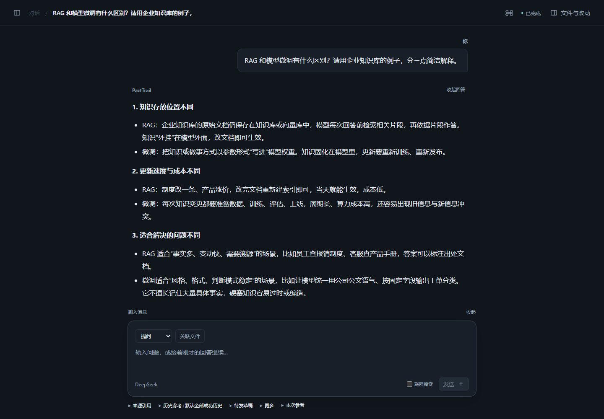

# PactTrail

[简体中文](README.zh-CN.md) · [Download](https://github.com/ToYOhin/PactTrail-Public/releases/tag/v0.1.0-prealpha.1) · [User guide](docs/USAGE.md)

A local agent workbench for conversations, source-backed reports, and file drafts you can review before applying.

**0.1.0 · Pre-Alpha · Windows x64 / CPython 3.13**



An ordinary conversation with a connected API. The interface is currently in Simplified Chinese.

- A compact dark interface with persistent history and saved input.
- Selected project snapshots, earlier answers, and artifacts as references.
- Context preview with editable excerpt summaries you can adopt or withdraw.
- Source inspection and draft review, with confirmation before writing files.

## Install and start

Install **CPython 3.13 x64**, download and extract the [Windows offline bundle](https://github.com/ToYOhin/PactTrail-Public/releases/tag/v0.1.0-prealpha.1), then follow the quick start below. See the [user guide](docs/USAGE.md) for sources, editing, model setup, and reopening.

<details>
<summary>Windows offline quick start</summary>

Open PowerShell in the extracted directory containing `candidate.json`. Choose a new installation directory:

```powershell
$python = (& py -3.13 -c 'import sys; print(sys.executable)').Trim()
$venv = Join-Path $env:LOCALAPPDATA 'PactTrail-0.1.0-venv'
powershell.exe -NoProfile -ExecutionPolicy Bypass -File .\scripts\install-candidate.ps1 -Python $python -Destination $venv
```

The installer checks the bundle hashes and installs included dependencies offline. Stop if installation fails. Python itself is not bundled; if `py` is unavailable, set `$python` to your CPython 3.13 executable's full path.

```powershell
$pacttrail = Join-Path $venv 'Scripts\pacttrail.exe'
$workspaceParent = Join-Path $env:LOCALAPPDATA 'PactTrail-workspaces'
New-Item -ItemType Directory -Force -Path $workspaceParent | Out-Null
& $pacttrail agent --workspace-dir (Join-Path $workspaceParent 'my-workspace')
```

Open the loopback address printed by the terminal. Startup sends no model requests; default responses are fixed offline demonstrations. Configure the supported model connection explicitly for live conversations. Stop with **Ctrl+C**, then repeat the same command to reopen. Explicitly save pending input before exiting.

</details>

## Scope

This is a project showcase and Pre-Alpha preview. Clean Windows installation, cross-platform operation, and general model quality remain unverified. Live models and optional web search require explicit use and may incur provider charges. There is no arbitrary shell or autonomous project-code execution.

## License

[Apache-2.0](LICENSE) · [NOTICE](NOTICE) · [Third-party notices](THIRD_PARTY_NOTICES.md)
