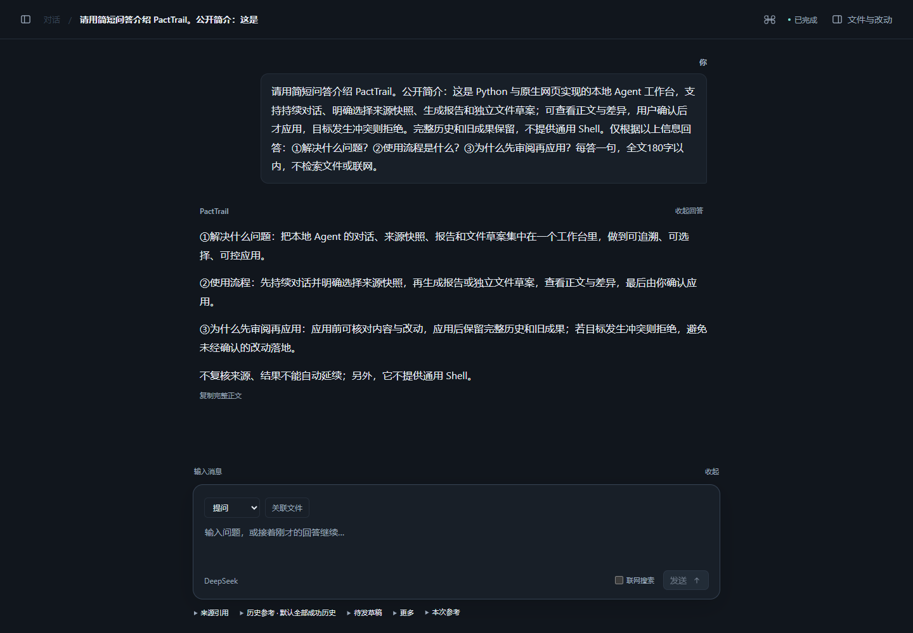

# PactTrail

[English](README.md) · [下载](https://github.com/ToYOhin/PactTrail-Public/releases/tag/v0.1.0-prealpha.1) · [使用说明](docs/USAGE.zh-CN.md)

运行在本机的 Agent 工作台：连续交流、结合来源生成报告，制作文件草案，审阅确认后再应用。

**0.1.0 · Pre-Alpha · Windows x64 / CPython 3.13**



围绕 PactTrail 的项目定位、使用流程和审阅机制进行真实 API 问答。界面为简体中文。

- 深色简洁界面，保留完整历史，支持显式保存待发输入。
- 选择项目快照、历史回答和成果作为本次参考。
- 预览上下文占用，明确采用或撤回可编辑的摘录摘要。
- 回看来源，审阅草案完整正文与差异，确认后才写入文件。

## 安装与启动

先安装 **CPython 3.13 x64**，下载并解压 [Windows 离线包](https://github.com/ToYOhin/PactTrail-Public/releases/tag/v0.1.0-prealpha.1)，按下方步骤启动。来源关联、文件修改、模型配置和重开方式见[使用说明](docs/USAGE.zh-CN.md)。

<details>
<summary>Windows 离线快速开始</summary>

在含 `candidate.json` 的解压目录打开 PowerShell，为安装选择不存在的新目录：

```powershell
$python = (& py -3.13 -c 'import sys; print(sys.executable)').Trim()
$venv = Join-Path $env:LOCALAPPDATA 'PactTrail-0.1.0-venv'
powershell.exe -NoProfile -ExecutionPolicy Bypass -File .\scripts\install-candidate.ps1 -Python $python -Destination $venv
```

安装器校验文件摘要，并从包内依赖离线安装。安装失败时停止，不继续启动。包内不含 Python；若没有 `py` 启动器，将 `$python` 改为 CPython 3.13 解释器的完整路径。

```powershell
$pacttrail = Join-Path $venv 'Scripts\pacttrail.exe'
$workspaceParent = Join-Path $env:LOCALAPPDATA 'PactTrail-workspaces'
New-Item -ItemType Directory -Force -Path $workspaceParent | Out-Null
& $pacttrail agent --workspace-dir (Join-Path $workspaceParent 'my-workspace')
```

打开终端本次显示的本机地址。启动不发送模型请求，默认回答为固定离线演示；真实交流需显式配置已支持的模型连接。按 **Ctrl+C** 退出，再用相同命令重开；退出前显式保存待发输入。

</details>

## 当前范围

本仓库用于项目展示，版本为 Pre-Alpha；干净 Windows 安装、跨平台和通用模型质量仍未验证。真实模型及可选联网搜索需要明确使用，可能产生服务商费用。不提供通用 Shell 或自主执行项目代码。

## 许可证

[Apache-2.0](LICENSE) · [NOTICE](NOTICE) · [第三方声明](THIRD_PARTY_NOTICES.md)
